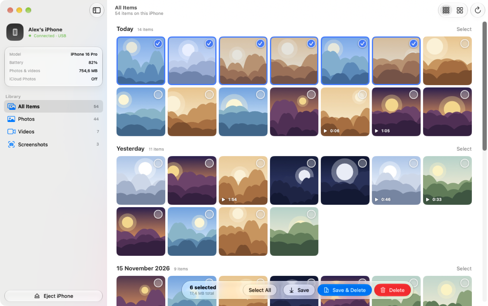
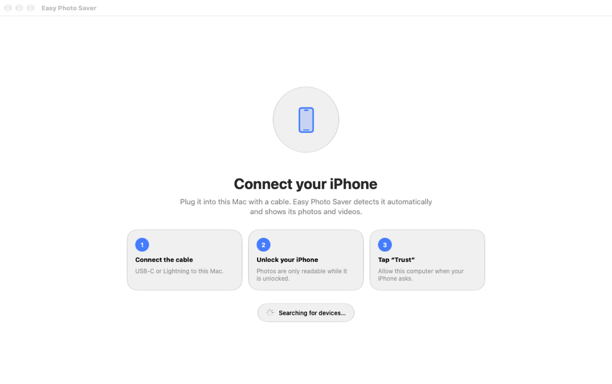
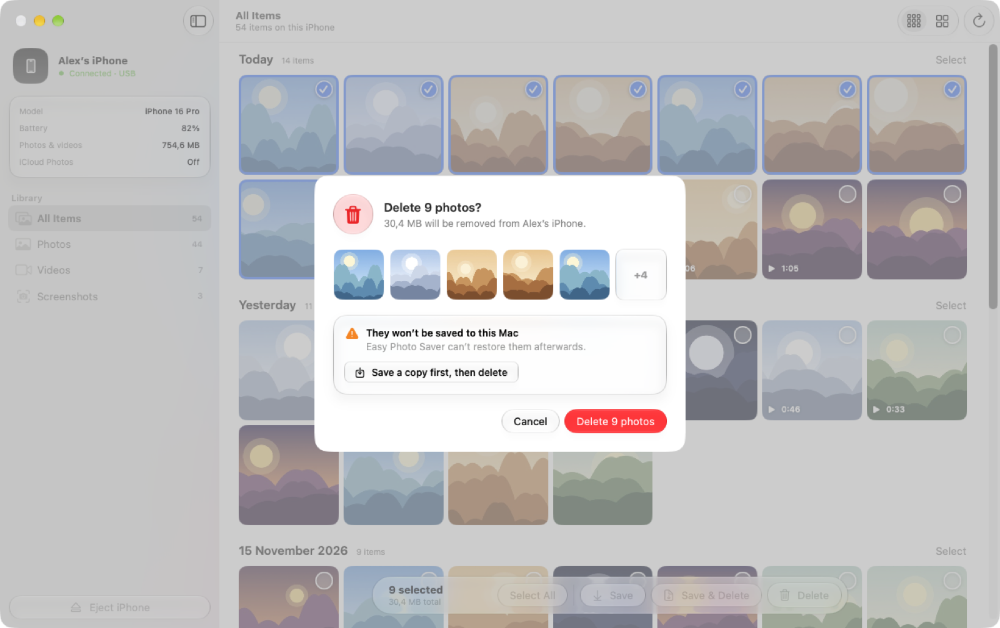
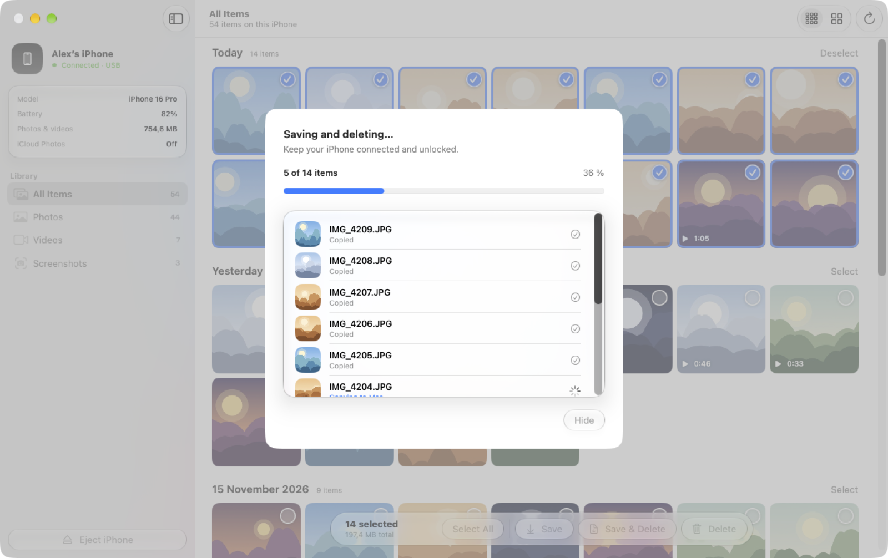
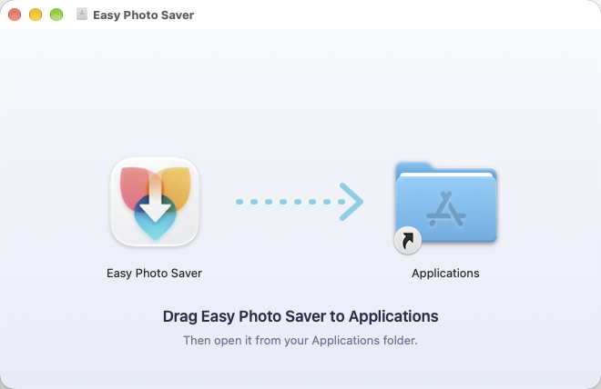

<div align="center">


# Easy Photo Saver

**Free up space on your iPhone from your Mac — without losing a single photo.**

Plug in your iPhone, pick what you want, and choose: keep a copy, keep a copy and delete it from the phone, or just delete it.



</div>

---

## How it works

### 1. Connect your iPhone

Plug your iPhone into your Mac with a cable and unlock it. The first time, your iPhone asks whether to **Trust** this computer. Tap **Trust** and enter your passcode.

Easy Photo Saver finds the iPhone on its own and walks you through each step.



### 2. Pick your photos and videos

Your library appears grouped by day, newest first.

- **Click** a photo to select it, or **Select** next to a day to pick the whole day.
- Use **Photos**, **Videos** and **Screenshots** on the left to see only one kind.
- Switch between **Default** and **Large** thumbnails at the top right.
- The bar at the bottom always shows how many items you picked and how much space they take.

### 3. Take a closer look

Not sure about a photo? Open it full size: hover over it and click the expand button, or right-click it and choose **Preview**. Videos play right there. Use **←** and **→** to move through your library and **Select** to pick the one you're looking at.


### 4. Choose what to do

| | Action | What happens |
|---|---|---|
| ⬇️ | **Save** | Copies the items to your Mac. Your iPhone stays as it is. |
| ✅ | **Save & Delete** | Copies the items to your Mac, checks every copy, then deletes them from the iPhone. **Best for freeing up space.** |
| 🗑️ | **Delete** | Deletes the items from the iPhone without keeping a copy. |

Before anything is deleted, Easy Photo Saver shows you exactly what will go and how much space you'll get back. If you chose **Delete**, you can still switch to **Save & Delete** with one click.



### 5. Watch it work

Each item shows its progress, and you'll see the result for every photo when it finishes.



By default, copies go to **Pictures › iPhone Import**, in one folder per day (for example `2026/11-17`). You can pick another folder before saving.

---

## Your photos are safe

Easy Photo Saver is careful by design:

- 🛡️ **Nothing is deleted until its copy is checked.** With **Save & Delete**, each photo is removed from the iPhone only after its copy on your Mac is complete. If a copy fails, the photo stays on your iPhone.
- 🔍 **No guessing about duplicates.** If a file with the same name is already on your Mac, Easy Photo Saver compares the two byte by byte before deciding it's the same photo.
- ✋ **You always confirm first.** Deleting asks you every time and shows what will be removed.

---

## Install

1. Download **EasyPhotoSaver.dmg** and open it.
2. Drag **Easy Photo Saver** onto the **Applications** folder.

   

3. Open Easy Photo Saver from your **Applications** folder. If macOS says it can't check the app, go to **System Settings › Privacy & Security** and click **Open Anyway**.

**Requires macOS 26 (Tahoe) or later** and an iPhone with its USB cable.

---

## Good to know

- **Only photos and videos.** Apple lets Mac apps reach the photos, videos and screenshots on an iPhone, nothing else. To free space used by apps, messages or caches, use **Settings › General › iPhone Storage** on the iPhone.
- **Recently Deleted.** Depending on your iPhone, deleted items may appear in **Recently Deleted** in the Photos app for a while. Empty that album to get the space back right away.
- **iCloud Photos.** If iCloud Photos is on, deleting from the iPhone can also delete the photo from iCloud and your other devices. The sidebar tells you whether it's on.
- **Some details aren't available.** Apple doesn't share the iOS version or total storage with Mac apps, and the model and battery appear only when the iPhone reports them.

---

<details>
<summary><strong>For developers</strong></summary>

### Requirements

- macOS 26 or later.
- **Xcode 26 or later** to build the app. Open `iPhotoManager.xcodeproj` and run the **iPhotoManager** scheme. The core and the adapters build and test with the Command Line Tools alone.

### Commands

```bash
./scripts/test.sh                            # run the test suite
swift run --package-path App PhotoManager    # quick debug run, without the sandbox
./scripts/build-app.sh                       # build build/Easy Photo Saver.app (sandboxed, universal)
./scripts/build-dmg.sh                       # build dist/EasyPhotoSaver-<version>.dmg
TEAM_ID=… ./scripts/archive-appstore.sh      # archive for the Mac App Store
./scripts/make-icon.sh                       # regenerate the app icon
./scripts/screenshots.sh                     # regenerate the README screenshots
```

### Build the DMG

`build-dmg.sh` builds the release app with `xcodebuild` and packs it into a DMG whose window shows the app, an arrow and an **Applications** shortcut. Styling the window drives Finder through AppleScript, so the first run may ask to let the terminal control Finder. It is configured with environment variables:

| Variable | Default | Purpose |
|---|---|---|
| `VERSION` | `1.0.0` | Version shown in the app and in the DMG name. |
| `BUILD_NUMBER` | commit count | `CFBundleVersion`. |
| `BUNDLE_ID` | `com.juanmotta.photomanager` | Bundle identifier. |
| `SIGN_IDENTITY` | `-` (ad-hoc) | A `Developer ID Application` identity to sign for distribution. |
| `NOTARY_PROFILE` | none | Keychain profile from `xcrun notarytool store-credentials`. When set, the DMG is notarized and stapled. |
| `PLAIN_DMG` | `0` | `1` skips the Finder styling, for machines without a desktop session (CI). |

```bash
# Signed and notarized for distribution
SIGN_IDENTITY="Developer ID Application: Your Name (TEAMID)" \
NOTARY_PROFILE=photo-manager \
VERSION=1.1.0 ./scripts/build-dmg.sh
```

The app is a universal binary (Apple silicon and Intel) and runs in the App Sandbox, like the App Store build.

### Publish on the Mac App Store

The App Store build comes from the same Xcode project. You need an Apple Developer account signed in to Xcode (**Settings › Accounts**) and the app created in App Store Connect with the bundle ID `com.juanmotta.photomanager`.

```bash
TEAM_ID=ABCDE12345 ./scripts/archive-appstore.sh            # export build/AppStore/
TEAM_ID=ABCDE12345 UPLOAD=1 ./scripts/archive-appstore.sh   # upload to App Store Connect
```

Or in Xcode: **Product › Archive**, then **Distribute App**. Signing and provisioning profiles are automatic.

What the project already covers for review:

| Requirement | Where |
|---|---|
| App Sandbox (guideline 2.4.5) | `App/iPhotoManager.entitlements`: USB for the iPhone, the Pictures folder, folders the user picks. |
| Built and packaged with Xcode | `iPhotoManager.xcodeproj` and `archive-appstore.sh`. |
| App icon in an asset catalog | `App/Xcode/Assets.xcassets`. |
| Privacy manifest | `App/Xcode/PrivacyInfo.xcprivacy`: no tracking, no data collected. |
| No hidden features | Demo mode is compiled only in debug builds. |

App Store Connect also asks for a privacy policy URL, and the reviewer needs an iPhone to test: explain that in the review notes.

### Icon and installer artwork

The icon artwork is `App/Resources/AppIcon-source.png`. `make-icon.sh` cuts its tile onto the macOS icon grid and writes every size into `App/Xcode/Assets.xcassets` (and `docs/images/icon.png`). The installer background is drawn in code by `scripts/artwork.swift` on every DMG build.

### Screenshots

The README images come from the real app running against a fake iPhone with generated pictures, so no personal photos are ever published. In debug builds, `PHOTO_MANAGER_DEMO=<scene>` starts the app in demo mode (`waiting`, `library`, `preview`, `confirm`, `progress`), and `scripts/screenshots.sh` captures each scene into `docs/images/`. The terminal running it needs Screen Recording permission.

### Architecture

Hexagonal architecture, split into two Swift packages so the domain and adapters build and test without Xcode:

```
Package.swift            PhotoManagerCore + PhotoManagerAdapters (+ tests)
App/Package.swift        PhotoManagerApp (SwiftUI) for quick `swift run` debugging
iPhotoManager.xcodeproj  The shipping app: same App/Sources, plus App/Xcode (assets, privacy
                         manifest) and App/iPhotoManager.entitlements
```

| Target | Role |
|---|---|
| `PhotoManagerCore` | Domain: `MediaItem`, `Selection`, `DeviceInfo`, `TransferService` and the ports `DeviceMonitor`, `DeviceSession`, `MediaTransferring`, `MediaStore`. No Apple device frameworks. |
| `PhotoManagerAdapters` | `ImageCaptureDeviceMonitor` and `ImageCaptureDeviceSession` (ImageCaptureCore), and `FileSystemMediaStore` (disk). |
| `PhotoManagerApp` | SwiftUI app and composition root. `AppModel` is the only type that talks to the domain; views are presentational. `Demo/` holds the fake iPhone used for screenshots. |

</details>
